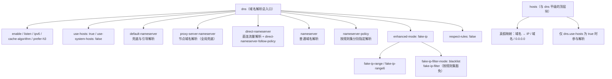
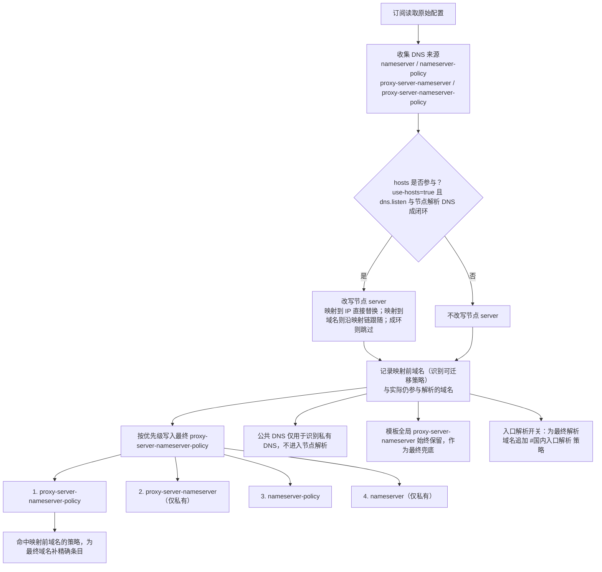
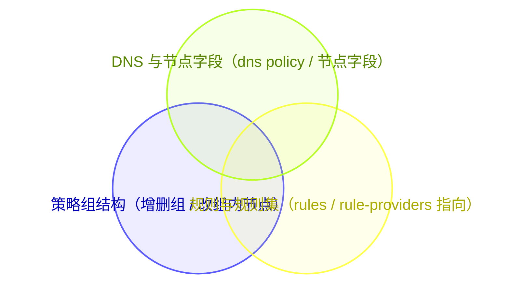
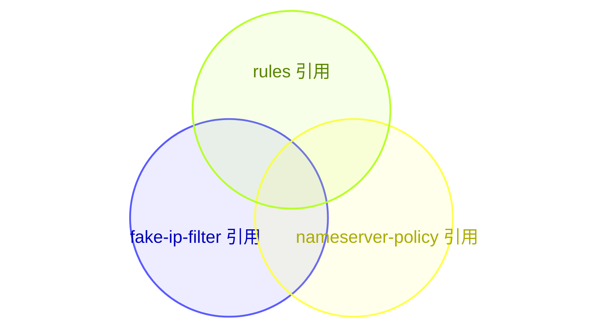
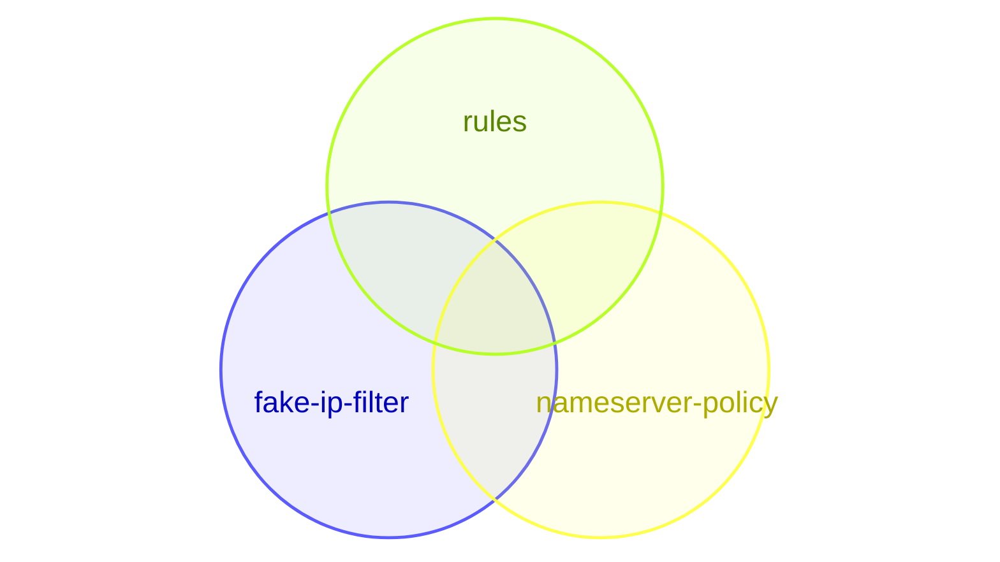

<p align="center">
  
</p>

<h1 align="center">XVSVT's Mihomic Config</h1>

<p align="center">
  <strong>自用</strong> · 路由配置 · 远程覆写脚本
</p>

<p align="center">
  <a href="LICENSE"></a>
  <a href="https://github.com/XVSVTsama/XVSVT-Clash-Config/commits/main"></a>
  <a href="https://github.com/XVSVTsama/XVSVT-Clash-Config"></a>
  <a href="https://github.com/XVSVTsama/XVSVT-Clash-Config/stargazers"></a>
  <a href="https://github.com/XVSVTsama"></a>
</p>

<p align="center">
  <a href="mihomo.yaml"></a>
  <a href="https://github.com/XVSVTsama/XVSVT-Clash-Config/actions/workflows/yaml-syntax.yml"></a>
  <a href="script_override.js"></a>
  <a href="https://github.com/XVSVTsama/XVSVT-Clash-Config/actions/workflows/js-syntax.yml"></a>
  <a href="https://github.com/XVSVTsama/XVSVT-Clash-Config/actions/workflows/mihomo-check.yml"></a>
</p>

<p align="center">
  <a href="#remote-override">远程覆写地址</a> ·
  <a href="#yaml-config">YAML 模板</a> ·
  <a href="#before-use">使用前必改</a> ·
  <a href="#dns-model">DNS 联动模型</a> ·
  <a href="#script-override">覆写脚本</a> ·
  <a href="#acknowledgments">致谢</a> ·
  <a href="#star-history">Star History</a> ·
  <a href="#disclaimer">免责声明</a>
</p>

---

<a id="remote-override"></a>

## 🔗 远程覆写脚本地址

   默认远程覆写脚本地址（代码块右上角可直接复制）：

```text
https://raw.githubusercontent.com/XVSVTsama/XVSVT-Clash-Config/refs/heads/main/script_override.js
```

<a id="yaml-config"></a>

## 🧱 YAML 模板（`mihomo.yaml`）

`mihomo.yaml` 是本仓库的基准配置模板，同时也是覆写脚本合并时使用的内嵌模板：一份不含任何节点的完整配置骨架。使用它的方式有两种：

- **直接导入**：把模板导入客户端，节点由 YAML 自己提供——替换 `proxies: ~`，或按需配置 `proxy-providers`；此方式不会从订阅自动导入节点，填写要求见 [使用前必改](#before-use)。
- **配合覆写脚本**：把页首地址挂到订阅上，由脚本把订阅节点与真实配置写进模板，无需手动维护节点列表，见 [覆写脚本](#script-override)。

模板内除 `dns` / `hosts` 与 `proxy-groups` 外的配置块：

- **`mode` 与端口**：`mode: rule`、`mixed-port` / `port` / `socks-port`、`external-controller` 与 `external-ui`。
- **`tun`**：TUN 入站，含 `device`、`stack`、`dns-hijack` 与 `route-address` 路由范围。
- **`sniffer` 与 `ntp`**：域名嗅探与时间同步。
- **`.templates`、`rule-providers`、`sub-rules`、`rules`**：规则集锚点定义、规则集来源、子规则与主规则表。

### 🧬 DNS 结构



<a id="proxy-groups"></a>

### 🗂 分流组结构（按 `mihomo.yaml` 定义）

| 策略组名称 | 默认行为 / 触发条件 | 注意事项 |
| :--- | :--- | :--- |
| **🌍 PROXY** | 未命中的所有默认海外流量 | 可选手动、自动或负载均衡 |
| **🔄 负载均衡** | 采用 `sticky-sessions` (粘性会话) 策略 | 保证同一域名短时间内 IP 不变 |
| **👉 手动切换** | 手动选择特定节点 | 模板中 `proxies:` 留空，需填节点或由脚本注入 |
| **♻️ 自动选择** | `url-test` 自动测试并选择延迟最低的节点 | 容差设置为 50ms |
| **🍎 海外苹果** | 未被前置直连规则匹配的 Apple 域名/IP | `echs_direct` 等通用直连规则优先；模板 `proxies: null` |
| **💠 海外微软** | 未被前置直连规则匹配的 Microsoft 域名/IP | `echs_direct` 等通用直连规则优先；模板 `proxies: null` |
| **🎮 Steam平台（非下载/CDN）** | Steam 域名/IP 规则 | `default-selected: DIRECT`；命中前置直连规则的国内游戏/下载会提前直连 |
| **📲 Telegram** | 匹配进程名、Telegram 域名与 CIDR 规则集 | 模板中为纯节点占位组 |
| **🎮 Games-Global** | 国际服游戏流量 | `default-selected: 🎮 Steam平台（非下载/CDN）`，嵌套该组 |
| **✖️ Twitter** | `filter` 匹配住宅/美国系命名节点，排除香港/新加坡节点 | 🚨 **节点命名不符将导致此策略组为空！** |
| **🤖 AI大模型** | `filter` 匹配住宅/美国系命名节点，排除香港/新加坡节点 | 🚨 **节点命名不符将导致此策略组为空！** |
| **🎵 TikTok** | `filter` 匹配住宅/美国系命名节点，排除香港/新加坡节点 | 🚨 **节点命名不符将导致此策略组为空！** |
| **FCM** | Google FCM 相关域名（`rules` 中 `googlefcm` 规则集的目标组） | 组内节点由 `FCM直连` 开关控制：开启=`DIRECT`；关闭=优先 `👉 手动切换` |

> 注：🔄 负载均衡 / 👉 手动切换 / ♻️ 自动选择 / 📲 Telegram 是纯节点占位组；🍎 海外苹果 / 💠 海外微软 / 🎮 Steam平台（非下载/CDN）/ 🎮 Games-Global 会先保留固定策略项，再由覆写脚本追加订阅全部单节点。不使用脚本时需手动填充节点。

<a id="before-use"></a>

### 🛠️ 使用前必改 (抄作业必看)

本配置按个人使用习惯定制，并非开箱即用的通用模板，尤其是对于直接导入 YAML 的使用形式。使用前请完成以下必要设置；如不熟悉 Mihomo、TUN、DNS 或策略组过滤规则，请先了解相关机制再使用。

1. **直接使用 YAML (`mihomo.yaml`)**：不使用 JavaScript 覆写脚本时，在 `mihomo.yaml` 中将 `proxies: ~` 替换为自己的节点列表，或按需配置 `proxy-providers`。此方式由 YAML 文件提供节点，不会从订阅自动导入。
2. **节点过滤规则 (Filter)**：配置默认使用长正则匹配住宅/美国系命名节点（住宅/家宽/家庭宽带/residential/home broadband/🇺🇸/美国/美國/U.S. 等多种命名变体），并排除香港/新加坡相关节点（🇭🇰/香港/Hong Kong/HK/🇸🇬/新加坡/Singapore/SG）。如果订阅节点名称不符合这些条件，可根据实际情况调整相关策略组的 `filter` 正则。
3. **按需删减规则**：如果你不需要屏蔽番茄小说海外版的广告，建议删除 `sub-rules` 中 `fanqie` 相关的规则，以节省性能。

<a id="dns-model"></a>

## 🌐 节点域名与 DNS 联动模型

[<kbd>在线阅读：节点域名、Hosts 与私有 DNS 联动模型</kbd>](https://XVSVTsama.github.io/XVSVT-Clash-Config/proxy-infrastructure-domain-protection-model.html)

> 本文档拆解了配置中 `hosts` 真假映射、私有 DoH 解析、DNS policy 与 fake-IP filter 的各自职责，以及四者如何在同一条节点解析链路里协同生效。它面向想要编写或理解节点解析覆写脚本的人，不包含任何真实节点、密码、UUID 或订阅凭据。

网页源码同仓库托管于 [`docs/proxy-infrastructure-domain-protection-model.html`](docs/proxy-infrastructure-domain-protection-model.html)。

<a id="script-override"></a>

## ⚙️ 覆写脚本（`script_override.js`）

覆写脚本把订阅配置与本仓库维护的内嵌模板合并成最终配置：模板中已写好的字段（`dns`、`rules`、`rule-providers`、`sniffer`、`tun`、`proxy-groups` 分组结构等）以模板为准，节点与订阅自带 `proxy-providers` 来自订阅。脚本地址见页首 [远程覆写脚本地址](#remote-override)，在 Bettbox / FlClash 系客户端中给订阅挂上即可。

合并产物：

- **节点与占位组**：订阅里的真实节点自动填入 `proxies` 与纯节点占位组（👉 手动切换、♻️ 自动选择、🔄 负载均衡、📲 Telegram）；🍎 海外苹果、💠 海外微软、🎮 Steam平台（非下载/CDN）、🎮 Games-Global 则先保留各自固定策略项，再追加全部订阅节点。
- **订阅自带 `proxy-providers`**：原样保留；存在时上述动态分组会同时写入 `use` 引用全部 provider。
- **DNS**：动态合并出 `dns.proxy-server-nameserver-policy`（模板不预置该键，以脚本计算结果为准），细节见下方流程图。
- **开关声明**：脚本首行的 `Compatible_With_Bettbox` 兼容声明必须置顶——Bettbox 只在脚本开头识别该声明，删除或下移会导致"自定义规则开关"入口不显示；声明中的 `policyGroupOptions` 列出归入图形化开关分类的 12 个策略组，`ruleOptionsEnable` 则是实际生效的开关表，键名需与声明保持一致。

### 🔀 hosts / DNS 处理流程



### 🗂 代理组（脚本合并后）

脚本合并后，属于 Bettbox 可视化开关分类的策略组如下，每个同名开关默认开启，关闭时该组会被移除并清理其他组与 `rules` 中的引用：

| 策略组名称 | Bettbox 开关 | 默认 | 关闭后的行为 |
| :--- | :--- | :--- | :--- |
| **🌍 PROXY** | `🌍 PROXY` | 开启 | 移除该组；引用回退到 `DIRECT` |
| **🔄 负载均衡** | `🔄 负载均衡` | 开启 | 移除该组并清理引用 |
| **👉 手动切换** | `👉 手动切换` | 开启 | 移除该组并清理引用 |
| **♻️ 自动选择** | `♻️ 自动选择` | 开启 | 移除该组并清理引用 |
| **📲 Telegram** | `📲 Telegram` | 开启 | 移除该组并清理引用；TGDC 开启时该开关同时管 `📲 Telegram(兜底)` |
| **🎮 Games-Global** | `🎮 Games-Global` | 开启 | 移除该组并清理引用 |
| **🍎 海外苹果** | `🍎 海外苹果` | 开启 | 移除该组并清理引用 |
| **💠 海外微软** | `💠 海外微软` | 开启 | 移除该组并清理引用 |
| **🎮 Steam平台（非下载/CDN）** | `🎮 Steam平台（非下载/CDN）` | 开启 | 移除该组并清理引用 |
| **✖️ Twitter** | `✖️ Twitter` | 开启 | 移除该组并清理引用 |
| **🤖 AI大模型** | `🤖 AI大模型` | 开启 | 移除该组并清理引用 |
| **🎵 TikTok** | `🎵 TikTok` | 开启 | 移除该组并清理引用 |

不在同名开关分类内、由功能开关决定存在形态的组：

| 策略组名称 | 控制方式 | 默认 | 说明 |
| :--- | :--- | :--- | :--- |
| **FCM** | `FCM直连` | 开启 | 开关不移除本组，只改写组内节点：开启=`DIRECT`；关闭且 `👉 手动切换` 已禁用时回退到全局兜底。脚本内嵌模板把本组标记为隐藏组（`hidden`） |
| **📲 Telegram(兜底)** | `TGDC实验分流` | 关闭 | 该开关开启时由 `📲 Telegram` 更名而来，承接 Telegram 进程、域名与 CIDR 规则 |
| **📲 Telegram-DC1-DC3-Miami** | `TGDC实验分流` | 关闭 | 开关开启时按 Telegram DC IP 规则优先命中美国/迈阿密节点；地区无候选时列出全部合格节点供手动选择 |
| **📲 Telegram-DC2-DC4-Amsterdam** | `TGDC实验分流` | 关闭 | 同上，对应荷兰/阿姆斯特丹节点 |
| **📲 Telegram-DC5-SG** | `TGDC实验分流` | 关闭 | 同上，DC5 同时匹配新加坡与香港节点 |
| **国内入口解析** | `入口解析` | 关闭 | 开关开启时注入电信/联通/移动三个入口节点并建立该组，由用户手动选择入口；排列顺序不代表优先级 |

### 🎚 Bettbox 开关

脚本把开关分成“12 个策略组同名开关”与“功能开关”两类，后者按改写的配置部位区分：



- **策略组同名开关（12 个，默认全开）**：🌍 PROXY、🔄 负载均衡、👉 手动切换、♻️ 自动选择、📲 Telegram、🎮 Games-Global、🍎 海外苹果、💠 海外微软、🎮 Steam平台（非下载/CDN）、✖️ Twitter、🤖 AI大模型、🎵 TikTok。关闭即移除该组，并把其他组与 `rules` 中的引用改指向全局兜底。
- **功能开关（6 个）**：`强制证书验证`（默认关，开启时统一把订阅节点 `skip-cert-verify` 置为 `false`）、`启用 Reality 增强`（默认开，为带 `public-key`/`short-id` 的 Reality 节点开启 X25519MLKEM768）、`IPv6优先`（默认关，按节点 `ip-version` 优先 IPv6）、`FCM直连`（默认开，仅改写 FCM 组内节点）、`TGDC实验分流`（默认关，注入 DC/地区组、规则集与规则）、`入口解析`（默认关，注入入口节点、代理组与 DNS 策略）。

> 上图为 `venn-beta`（Mermaid 11.12.3+ 才有），需要 GitHub 当前渲染版本支持，见文末 [渲染自检](#render-check)；若渲染失败将改用树状图描述。

### 🧮 规则集重合关系（额外说明）

同一批规则集会被不同位置引用，下面按“引用方”展示重合关系（`dns` 与 `rules` 共同的引用是本配置里最需要保持一致的部分）：



- `fake-ip-filter` 引用：`fakeip-filter_domain`、`private`、`cn`、`echs_direct`、`googlefcm`、`applications`、`pixiv`
- `nameserver-policy` 引用：`douyin`、`private`、`cn`、`echs_direct`、`proxy@direct`
- `rules` 引用：`applications`、`echs_direct`、`echs_direct_ip`、`cn`、`cncidr`、`microsoft`、`microsoft_ip`、`apple`、`apple_ip`、`googlefcm`、`proxy@direct`、`private`、`lancidr`、`telegramcidr`、`telegram_domain`、`Gemini_Domain`、`Grok_Domain`、`ai-1`、`ai-2`、`google`、`google-cn`、`twitter-x-domain`、`twitter-x-ip`、`twitter-x-blackmatrix7-No_Resolve`、`steam`、`steam_ip`、`games`、`TikTok`、`proxy`、`gfw`
- 三者共同引用：`cn`、`echs_direct`、`private`——改动这三个规则集或它们的优先级时需同时确认 DNS 与规则两侧。

> 同 `venn-beta` 说明：待 GitHub 渲染验证，见 [渲染自检](#render-check)。

<a id="render-check"></a>

### 🧪 渲染自检（临时内容，合并前删除）

本小节用于确认 GitHub 当前的 Mermaid 版本，以及两个 beta 图类型是否可用；确认后再决定正文树状图与韦恩图的最终写法。

```mermaid
  info
```

`treeView-beta`（Mermaid 11.14.0+）目录树：


`venn-beta`（Mermaid 11.12.3+）集合图：



---

<a id="acknowledgments"></a>

## 🙏 致谢

本项目建立在开源内核、客户端、规则集与图标资源之上。以下列出本项目使用或参考的相关项目；引用或参考不代表这些项目与本仓库存在合作或背书关系。具体资源请以各上游项目的说明和许可为准。

### 内核与客户端

- [Mihomo](https://github.com/MetaCubeX/mihomo)
- [Bettbox](https://github.com/appshubcc/Bettbox)
- [FlClash](https://github.com/chen08209/FlClash)

### 规则集作者与原项目

- [MetaCubeX/meta-rules-dat](https://github.com/MetaCubeX/meta-rules-dat)
- [DustinWin/ruleset_geodata](https://github.com/DustinWin/ruleset_geodata)
- [echs-top/proxy](https://github.com/echs-top/proxy)
- [appshubcc/bett-rules](https://github.com/appshubcc/bett-rules)
- [reddishJade/private_proxy](https://github.com/reddishJade/private_proxy)
- [Accademia/Additional_Rule_For_Clash](https://github.com/Accademia/Additional_Rule_For_Clash)
- [Loyalsoldier/clash-rules](https://github.com/Loyalsoldier/clash-rules)
- [blackmatrix7/ios_rule_script](https://github.com/blackmatrix7/ios_rule_script)

### 图标作者与原项目

- [Koolson/Qure](https://github.com/Koolson/Qure) 与 [MiToverG422/Qure](https://github.com/MiToverG422/Qure)
- [DustinWin/ruleset_geodata](https://github.com/DustinWin/ruleset_geodata)
- [AIsouler/MyClash](https://github.com/AIsouler/MyClash)
- [Clash Verge](https://www.clashverge.dev/)
- 荷兰国旗图标由本项目自行绘制，并托管于 [`assets/icons/self-Netherlands.png`](assets/icons/self-Netherlands.png)。

图标副本统一托管在 `assets/icons/` 并通过 jsDelivr 引用。

### 脚本与配置参考

- [AIsouler/MyClash](https://github.com/AIsouler/MyClash)
- [echs-top/proxy](https://github.com/echs-top/proxy)
- [HenryChiao/MIHOMO_YAMLS](https://github.com/HenryChiao/MIHOMO_YAMLS)

以上参考均用于学习与对照，具体实现以本仓库代码为准。

<a id="star-history"></a>

## ⭐ Star History

[](https://star-history.com/#XVSVTsama/XVSVT-Clash-Config&Date)

<a id="disclaimer"></a>

## ⚠️ 免责声明

1. 本仓库的YAML模板与JS脚本设计并非完美，或可能有代码质量问题，也不一定适合所有环境，尤其是 DNS 与路由规则。
2. 使用者应自行评估使用、修改或传播本仓库内容所涉及的风险，并遵守所在地区适用的法律法规。因使用本仓库内容产生的后果，由使用者自行承担。
