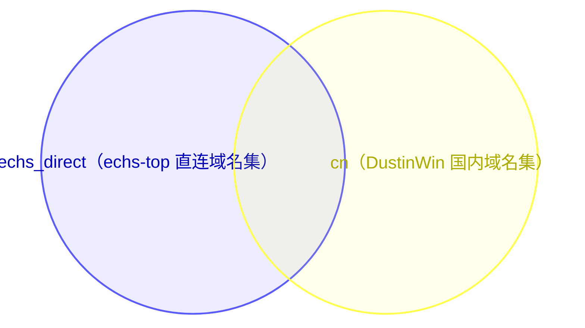
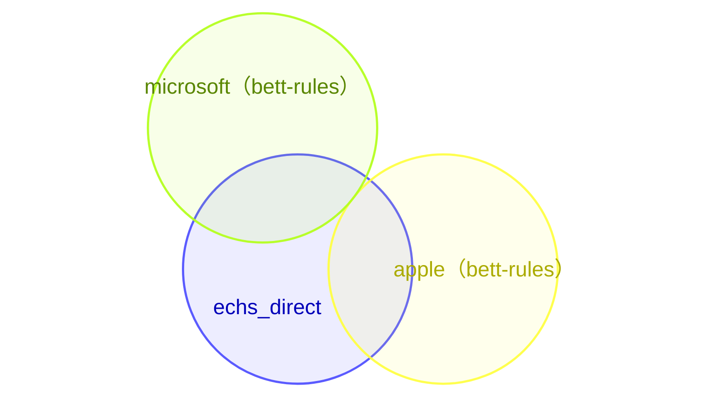
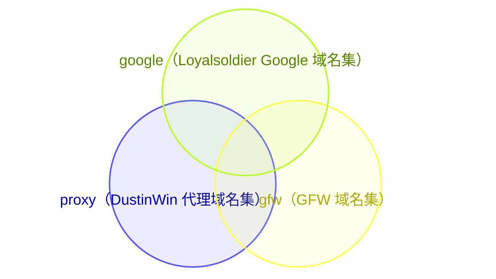
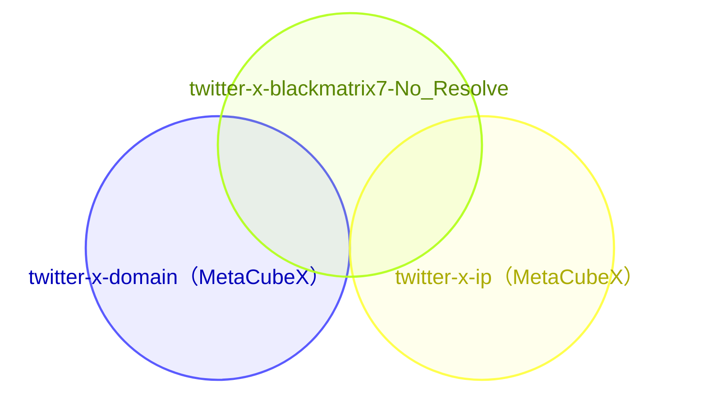
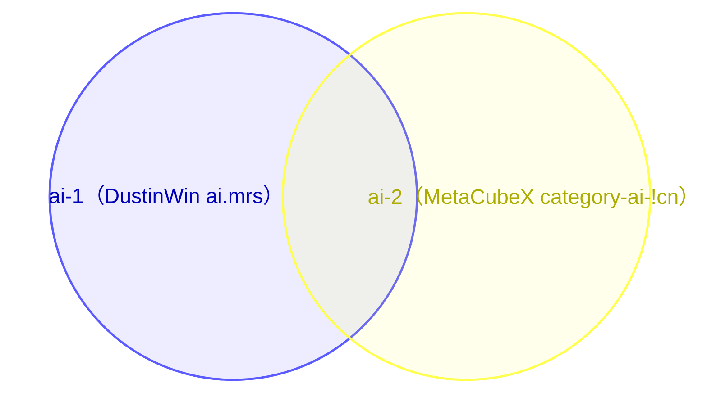

<p align="center">
  
</p>

<h1 align="center">XVSVT's Mihomic Config</h1>

<p align="center">
  <strong>自用</strong> · 路由配置 · 远程覆写脚本
</p>

<p align="center">
  <a href="LICENSE"></a>
  <a href="https://github.com/XVSVTsama/XVSVT-Clash-Config/commits/main"></a>
  <a href="https://github.com/XVSVTsama/XVSVT-Clash-Config"></a>
  <a href="https://github.com/XVSVTsama/XVSVT-Clash-Config/stargazers"></a>
  <a href="https://github.com/XVSVTsama"></a>
</p>

<p align="center">
  <a href="mihomo.yaml"></a>
  <a href="https://github.com/XVSVTsama/XVSVT-Clash-Config/actions/workflows/yaml-syntax.yml"></a>
  <a href="script_override.js"></a>
  <a href="https://github.com/XVSVTsama/XVSVT-Clash-Config/actions/workflows/js-syntax.yml"></a>
  <a href="https://github.com/XVSVTsama/XVSVT-Clash-Config/actions/workflows/mihomo-check.yml"></a>
</p>

<p align="center">
  <a href="#remote-override">远程覆写地址</a> ·
  <a href="#yaml-config">YAML 说明</a> ·
  <a href="#script-override">JavaScript 说明</a> ·
  <a href="#dns-model">dns-host背景说明</a> ·
  <a href="#ruleset-overlap">规则集重合</a> ·
  <a href="#acknowledgments">致谢</a> ·
  <a href="#star-history">Star History</a> ·
  <a href="#disclaimer">免责声明</a>
</p>

---

<a id="remote-override"></a>

## 🔗 远程覆写脚本地址

   默认远程覆写脚本地址（代码块右上角可直接复制）：

```text
https://raw.githubusercontent.com/XVSVTsama/XVSVT-Clash-Config/refs/heads/main/script_override.js
```

<a id="yaml-config"></a>

<br>

<h2 align="center">🧱 YAML 说明</h2>

<br>

`mihomo.yaml` 是本仓库的基准配置模板，同时也是覆写脚本合并时使用的内嵌模板：一份不含任何节点的完整配置骨架，不可直接使用它。

<a id="proxy-groups"></a>

### 🗂 分流组结构（按 `mihomo.yaml` 定义）

本节分三层：先看核心代理组的骨架与嵌套，再看每个基础代理组的用途与分流，最后看三组的特别说明。

#### 核心代理组

| 代理组 | 嵌套关系 |
| :--- | :--- |
| **🌍 PROXY** | 唯一的顶层入口，不直接纳入节点（无 `include-all`），实际节点经被嵌套的三组进入；组内只有以下四项：<br>`👉 手动切换`<br>`♻️ 自动选择`<br>`🔄 负载均衡`<br>`DIRECT` |
| **👉 手动切换** | 被 **🌍 PROXY** 嵌套；自身以 `include-all` 纳入所有可用节点，不再嵌套其他代理组 |
| **♻️ 自动选择** | 被 **🌍 PROXY** 嵌套；自身以 `include-all` 纳入所有可用节点，不再嵌套其他代理组 |
| **🔄 负载均衡** | 被 **🌍 PROXY** 嵌套；自身以 `include-all` 纳入所有可用节点，不再嵌套其他代理组 |

**与基础代理组的关系**——共性：基础代理组中的常规业务组（含 `🎮 Steam平台（非下载/CDN）`）都嵌套核心三组并加 `DIRECT` 作为可选项，在业务组里选核心三组即借用其节点集合与选择方式。差异逐组如下：

| 核心组 | 在基础代理组中的嵌套情况 |
| :--- | :--- |
| **🔄 负载均衡** | 常规业务组均嵌套本组；`🎮 Games-Global`、`FCM` 不嵌套本组（Games-Global 经 Steam 组间接使用） |
| **👉 手动切换** | 常规业务组均嵌套本组；此外 `FCM` 也嵌套本组，且本组是 `FCM` 唯一嵌套的代理组；`🎮 Games-Global` 不直接嵌套，经 Steam 组间接使用 |
| **♻️ 自动选择** | 常规业务组均嵌套本组；`🎮 Games-Global`、`FCM` 不嵌套本组（Games-Global 经 Steam 组间接使用） |

#### 基础代理组

| 代理组 | 用途 | 分流说明 |
| :--- | :--- | :--- |
| **🌍 PROXY** | 全局代理出口与最终兜底 | `DOMAIN-KEYWORD,ikuuu`、`proxy@direct` / `proxy` / `gfw` 规则集指向本组，未命中其他规则的流量由 `MATCH` 兜底到本组 |
| **👉 手动切换** | 手动选择单个节点 | 无规则直接指向本组，由其他代理组嵌套调用；`include-all` 纳入所有可用节点 |
| **♻️ 自动选择** | 自动测速选优 | 无规则直接指向本组，由其他代理组嵌套调用；`url-test` 类型，`include-all` 纳入所有可用节点 |
| **🔄 负载均衡** | 多节点负载均衡 | 无规则直接指向本组，由其他代理组嵌套调用；`load-balance` 类型（`sticky-sessions`），`include-all` 纳入所有可用节点 |
| **🍎 海外苹果** | 海外 Apple 服务单独选出口 | `apple` 域名集与 `apple_ip` IP 集（`no-resolve`） |
| **💠 海外微软** | 海外 Microsoft 服务单独选出口 | `microsoft` 域名集与 `microsoft_ip` IP 集（`no-resolve`） |
| **📲 Telegram** | Telegram 单独选出口 | `telegram_domain` 域名集、`telegramcidr` IP 集（`no-resolve`），及 Telegram / Nagram 进程名正则 |
| **✖️ Twitter** | Twitter / X 单独选出口 | `twitter-x-domain`、`twitter-x-ip`（`no-resolve`）、`twitter-x-blackmatrix7-No_Resolve` 三套规则集，及 Twitter 进程名正则 |
| **🤖 AI大模型** | AI 服务单独选出口 | `ai-1` / `ai-2` 规则集、`Gemini_Domain` / `Grok_Domain` 域名集，及 Claude / Anthropic、Manus、Muse 等域名、进程与 IP 段直达规则 |
| **🎵 TikTok** | TikTok 单独选出口 | `TikTok` 规则集 |
| **💳 金融支付** | 支付与加密货币单独选出口 | `category-cryptocurrency` 及 PayPal、Stripe、Visa、Mastercard、Wise 规则集，及交易所 / 钱包 App 进程名 |
| **🔎 Google** | Google 服务单独选出口 | `google` 与 `google-cn` 两套规则集；FCM 不在本组，见特别组说明 |
| **♾️ Meta** | Meta 服务单独选出口 | `meta` 规则集 |
| **🎧 Spotify** | Spotify 单独选出口 | `spotify` 规则集 |
| **🎬 Emby** | Emby 类客户端单独选出口 | 无规则集，仅按 7 个 Emby 类客户端进程名分流 |
| **💬 Discord** | Discord 单独选出口 | `discord` 规则集 |
| **👽 Reddit** | Reddit 单独选出口 | `reddit` 规则集 |
| **🎥 Netflix** | Netflix 单独选出口 | `netflix` 规则集 |
| **💝 Patreon** | Patreon 单独选出口 | `patreon` 规则集 |
| **📚 EHentai** | EHentai 单独选出口 | `ehentai` 规则集 |
| **☁️ PikPak** | PikPak 单独选出口 | `pikpak` 规则集 |
| **💬 LINE** | LINE 单独选出口 | `line` 规则集 |
| **🎮 Games-Global** | 游戏流量单独选出口 | `games` 规则集及 `bf6.exe` 进程；特别说明见下 |
| **🎮 Steam平台（非下载/CDN）** | Steam 平台流量单独选出口 | `steam` 域名集与 `steam_ip` IP 集（`no-resolve`）；特别说明见下 |
| **FCM** | Google FCM 推送单独选出口 | `googlefcm` 规则集；特别说明见下 |

#### 特别组说明

以下三组同时属于基础代理组（见上表），因结构与默认行为不同于常规业务组，单独说明。

| 代理组 | 特别说明 |
| :--- | :--- |
| **🎮 Games-Global** | 结构：唯一嵌套另一个业务组的代理组，固定策略项只有 `🎮 Steam平台（非下载/CDN）`，另以 `include-all` 纳入的节点可直接改选<br>默认：默认选中 Steam 组，实际出口随 Steam 组的当前选择走<br>规则关联：`games` 规则集被 WebRTC 阻断规则列为豁免，命中它的 UDP 不按 STUN 端口拦截 |
| **🎮 Steam平台（非下载/CDN）** | 范围：只承接 `steam` / `steam_ip` 规则集的 Steam 平台流量，不含下载 / CDN 流量<br>默认：`DIRECT` 排首位且为默认选中，未手动改选时平台流量默认直连<br>嵌套：被 `🎮 Games-Global` 嵌套，是唯一既是规则的直接分流目标、又被其他组嵌套的业务组 |
| **FCM** | 结构：只有 `👉 手动切换` 与 `DIRECT` 两项，无 `include-all`，不能在本组直接选具体节点<br>范围：只承接 `googlefcm` 规则集，与 `🔎 Google` 的 `google` / `google-cn` 分开<br>脚本：合并后本组的组内节点由 `FCM直连` 开关改写，见 JavaScript 说明 |

<a id="before-use"></a>

### 🛠️ 使用前必改 (抄作业必看)

本配置按个人使用习惯定制，并非开箱即用的通用模板，尤其是对于直接导入 YAML 的使用形式。使用前请完成以下必要设置；如不熟悉 Mihomo、TUN、DNS 或策略组过滤规则，请先了解相关机制再使用。

1. **直接使用 YAML (`mihomo.yaml`)**：不使用 JavaScript 覆写脚本时，将 `proxy-providers.subscription.url` 的占位地址在本地替换为自己的 Clash/Mihomo 订阅链接；`include-all` 策略组会自动纳入 provider 节点。也可删除不用的示例 provider，将 `proxies: ~` 替换为自己的节点列表。模板不会自动读取客户端中的其他订阅，请勿把真实订阅链接或凭据提交到公开仓库。
2. **按需删减规则**：如果你不需要屏蔽番茄小说海外版的广告，建议删除 `sub-rules` 中 `fanqie` 相关的规则，以节省性能。

<a id="script-override"></a>

<br>

<h2 align="center">⚙️ JavaScript 说明</h2>

<br>

覆写脚本把订阅配置与本仓库维护的内嵌模板合并成最终配置：模板中已写好的字段（`dns`、`rules`、`rule-providers`、`sniffer`、`tun`、`proxy-groups` 分组结构等）以模板为准，节点与订阅自带 `proxy-providers` 来自订阅。脚本地址见页首 [远程覆写脚本地址](#remote-override)，在 Bettbox / FlClash 系客户端中给订阅挂上即可。

合并产物：

- **节点与代理组**：订阅里的真实节点填入顶层 `proxies`；常规动态节点组通过 Mihomo 原生 `include-all` 引入顶层节点与 provider 节点。固定策略项保留在各组的 `proxies` 列表中。
- **订阅自带 `proxy-providers`**：原样保留；使用 `include-all` 的代理组会原生纳入这些 provider。脚本生成的 TGDC 实验地区组仍使用 `include-all-proxies` 或显式保底列表，不纳入 provider 运行时节点。
- **国家/地区分组**：`国家/地区分组` 开启后，只从订阅顶层 `proxies` 生成香港、日本、新加坡、台湾、美国、加拿大、英国、法国、荷兰、德国、澳大利亚及“其他国家/地区”策略组；不枚举 `proxy-providers`。倍率筛选在地区组生成之后执行；即使某地区的节点全部被筛除，父组和四个隐藏子组仍保留。
- **倍率筛选**：`高倍率筛选` 删除名称中明确标记为 `2x` 或更高的订阅顶层节点；`低倍率筛选` 删除明确标记为 `0.5x` 或更低的节点。只识别显式数值倍率（例如 `5x`），不猜测模糊标签；过滤同步清理代理组 `proxies` 中的节点名称引用，不处理 `proxy-providers`，并在国内入口解析节点注入之前执行。
- **DNS**：动态合并出 `dns.proxy-server-nameserver-policy`（模板不预置该键，以脚本计算结果为准），细节见下方流程图。
- **开关声明**：脚本首行的 `Compatible_With_Bettbox` 兼容声明必须置顶——Bettbox 只在脚本开头识别该声明，删除或下移会导致"自定义规则开关"入口不显示；声明中的 `policyGroupOptions` 列出归入图形化开关分类的 23 个策略组，`ruleOptionsEnable` 则是实际生效的开关表，键名需与声明保持一致。`🌍 PROXY` 始终保留为基础/兜底组，不提供关闭开关。

### 🔀 hosts / DNS 处理流程

[<kbd>在线查看：hosts / DNS 三种处理流程</kbd>](https://XVSVTsama.github.io/XVSVT-Clash-Config/hosts-dns-processing-flow.html)

### 🗂 代理组与 Bettbox 开关（脚本合并后）

脚本开头的 `Compatible_With_Bettbox` 声明用 `policyGroupOptions` 划定了"策略组开关"分类：只列进去的组出现在该分类下，没列进去的组不受它控制，改由脚本的 `ruleOptionsEnable` 决定存在形态（两者都在脚本顶部可查）。

**列入 `policyGroupOptions` 的策略组（23 个）**

| 策略组名称 | Bettbox 开关 | 默认 |
| :--- | :--- | :--- |
| **🔄 负载均衡** | `🔄 负载均衡` | 开启 |
| **👉 手动切换** | `👉 手动切换` | 开启 |
| **♻️ 自动选择** | `♻️ 自动选择` | 开启 |
| **📲 Telegram** | `📲 Telegram` | 开启 |
| **🎮 Games-Global** | `🎮 Games-Global` | 开启 |
| **🍎 海外苹果** | `🍎 海外苹果` | 开启 |
| **💠 海外微软** | `💠 海外微软` | 开启 |
| **🎮 Steam平台（非下载/CDN）** | `🎮 Steam平台（非下载/CDN）` | 开启 |
| **✖️ Twitter** | `✖️ Twitter` | 开启 |
| **🤖 AI大模型** | `🤖 AI大模型` | 开启 |
| **🎵 TikTok** | `🎵 TikTok` | 开启 |
| **💳 金融支付** | `💳 金融支付` | 开启 |
| **🔎 Google** | `🔎 Google` | 开启 |
| **♾️ Meta** | `♾️ Meta` | 开启 |
| **🎧 Spotify** | `🎧 Spotify` | 开启 |
| **🎬 Emby** | `🎬 Emby` | 开启 |
| **💬 Discord** | `💬 Discord` | 开启 |
| **👽 Reddit** | `👽 Reddit` | 开启 |
| **🎥 Netflix** | `🎥 Netflix` | 开启 |
| **💝 Patreon** | `💝 Patreon` | 开启 |
| **📚 EHentai** | `📚 EHentai` | 开启 |
| **☁️ PikPak** | `☁️ PikPak` | 开启 |
| **💬 LINE** | `💬 LINE` | 开启 |

这 23 个开关默认全部开启。关闭 20 个业务分流组时，会移除该组并删除指向它的路由规则，而不是把规则改写到 `🌍 PROXY`；只有在剩余规则和配置中均无引用的规则集才会清理。关闭 `🔄 负载均衡`、`👉 手动切换` 或 `♻️ 自动选择` 时仍沿用原有组引用和兜底处理。`🌍 PROXY` 始终保留为基础/兜底组。

**未列入 `policyGroupOptions` 的组**

| 策略组名称 | 由哪个开关决定 | 默认 | 说明 |
| :--- | :--- | :--- | :--- |
| **FCM** | `FCM直连` | 开启 | 开关不移除本组，只改写组内节点：开启=`DIRECT`；关闭且 `👉 手动切换` 已禁用时回退到全局兜底。脚本内嵌模板把本组标记为隐藏组（`hidden`） |
| **📲 Telegram(兜底)** | `TGDC实验分流` | 关闭 | 该开关开启时由 `📲 Telegram` 更名而来，承接 Telegram 进程、域名与 CIDR 规则 |
| **📲 Telegram-DC1-DC3-Miami** | `TGDC实验分流` | 关闭 | 开关开启时按 Telegram DC IP 规则优先命中美国/迈阿密节点；地区无候选时列出全部合格节点供手动选择 |
| **📲 Telegram-DC2-DC4-Amsterdam** | `TGDC实验分流` | 关闭 | 同上，对应荷兰/阿姆斯特丹节点 |
| **📲 Telegram-DC5-SG** | `TGDC实验分流` | 关闭 | 同上，DC5 同时匹配新加坡与香港节点 |
| **国内入口解析** | `入口解析` | 关闭 | 开关开启时统一注入维护区所有运营商的入口节点并建立该组，由用户手动选择入口；每个运营商支持多个节点，排列顺序不代表优先级 |
| **国家/地区父组及隐藏子组** | `国家/地区分组` | 关闭 | 根据地区候选节点创建分组；将父组追加到 15 个指定流量目标中，跳过已禁用或不存在的目标；倍率筛选后即使组内无节点也保留父组和四个隐藏子组 |

**同样不在 `policyGroupOptions`、也不对应任何策略组的开关（9 个）**

| 开关 | 默认 | 作用 |
| :--- | :--- | :--- |
| `强制证书验证` | 关闭 | 开启时统一把订阅节点的 `skip-cert-verify` 置为 `false`；关闭时不干预订阅节点原有设置 |
| `启用 Reality 增强` | 开启 | 为带非空 `public-key` / `short-id` 的 Reality 节点启用 X25519MLKEM768 后量子密钥协商 |
| `IPv6优先` | 关闭 | 改写顶层节点 `ip-version`：`ipv6` 保持不变，`ipv6-prefer` 改为 `ipv6`，其余设为 `ipv6-prefer`；不处理 provider 运行时节点 |
| `国家/地区分组` | 关闭 | 只用订阅顶层节点生成国家/地区选择组；共用官网、流量说明等节点过滤，但不改变原节点列表或目标组的 `include-all`。该开关独立于 `入口解析` |
| `高倍率筛选` | 关闭 | 删除名称中显式标记倍率 `>=2x` 的订阅顶层节点，并从静态代理组节点列表中移除其名称；不处理 provider 运行时节点 |
| `低倍率筛选` | 关闭 | 删除名称中显式标记倍率 `<=0.5x` 的订阅顶层节点，并从静态代理组节点列表中移除其名称；不处理 provider 运行时节点 |
| `代理节点 DNS 使用 TCP` | 关闭 | 为代理节点解析 DNS 中未标协议的地址启用 TCP；显式协议不变 |
| `WebRTC阻断` | 开启 | 开启时保持模板规则不变；关闭时移除所有同时包含 `NETWORK,UDP` 与 `DST-PORT,3478-3479/5349-5350/19302-19309` 的规则 |
| `试开启节点UDP` | 关闭 | 开启时为订阅顶层节点设置 `udp: true`，允许 UDP 通过代理；关闭时不改动节点原值。Mihomo [官方通用字段文档](https://wiki.metacubex.one/config/proxies/) 说明该字段默认通常为 `false`，TUIC 等基于 UDP 的协议以及 `direct`、`dns` 类型默认开启 |

> **关于客户端**：这套图形化开关由 Bettbox 原生支持——脚本开头的 `Compatible_With_Bettbox` 声明就是给 Bettbox 识别用的。换到其他客户端分两种情况：
>
> - 支持 JS 覆写脚本、但没有开关面板的客户端（例如 FlClash）：需要自行打开 `script_override.js`，把 `ruleOptionsEnable` 里对应开关的值改成 `true` 或 `false`，保存后重新加载订阅即可生效；
> - 不支持 JS 覆写脚本的客户端：没有这个入口，只能改用 `mihomo.yaml` 模板自行维护策略组。

<a id="dns-model"></a>

<br>

<h2 align="center">hosts真假域名映射-私有DoH复合DNS流程</h2>

<br>

[<kbd>在线阅读：节点域名、Hosts 与私有 DNS 联动模型</kbd>](https://XVSVTsama.github.io/XVSVT-Clash-Config/proxy-infrastructure-domain-protection-model.html)

<a id="ruleset-overlap"></a>

<br>

<h2 align="center">🧮 规则集重合关系（额外说明）</h2>

<br>

本小节不属于 YAML 或脚本单方面的说明：本仓库引用的规则集来自多个上游，彼此存在规则集与规则集之间的覆盖重合。下面按重合的集合分组，全部用韦恩图说明。

**1. 国内直连的两个来源**



两组规则有部分重合；重合域名按配置顺序先命中 `echs_direct`，两组最终都走 `DIRECT`。

**2. 直连规则集与海外组规则集**



`apple` / `microsoft` 的国内部分落在 `echs_direct` 里，`rules` 把 `echs_direct` 排在海外组之前，重合部分先走 `DIRECT`；`games` 与 `echs_direct` 同理。

**3. 出海域名集的多个来源**



三者覆盖的都是"需要走代理的域名"，在 `rules` 中同指 `🌍 PROXY`。

**4. Twitter 的三套规则集**



blackmatrix7 的 `No_Resolve` 集同时包含域名与 IP，与 MetaCubeX 的两套各自重合。

**5. 两套 AI 规则集**



两套来源不同却覆盖同类站点，在 `rules` 中同指 `🤖 AI大模型`。

> 以上重合关系按各规则集的覆盖范围与来源判断（依据取自 `mihomo.yaml` 的 `rules:` 引用与注释）。

---

<a id="acknowledgments"></a>

<br>

<h2 align="center">🙏 致谢</h2>

<br>

本项目建立在开源内核、客户端、规则集与图标资源之上。以下列出本项目使用或参考的相关项目；引用或参考不代表这些项目与本仓库存在合作或背书关系。具体资源请以各上游项目的说明和许可为准。

### 内核与客户端

- [Mihomo](https://github.com/MetaCubeX/mihomo)
- [Bettbox](https://github.com/appshubcc/Bettbox)
- [FlClash](https://github.com/chen08209/FlClash)

### 规则集作者与原项目

- [MetaCubeX/meta-rules-dat](https://github.com/MetaCubeX/meta-rules-dat)
- [DustinWin/ruleset_geodata](https://github.com/DustinWin/ruleset_geodata)
- [echs-top/proxy](https://github.com/echs-top/proxy)
- [appshubcc/bett-rules](https://github.com/appshubcc/bett-rules)
- [reddishJade/private_proxy](https://github.com/reddishJade/private_proxy)
- [Accademia/Additional_Rule_For_Clash](https://github.com/Accademia/Additional_Rule_For_Clash)
- [Loyalsoldier/clash-rules](https://github.com/Loyalsoldier/clash-rules)
- [blackmatrix7/ios_rule_script](https://github.com/blackmatrix7/ios_rule_script)


### 图标作者与原项目

- [Koolson/Qure](https://github.com/Koolson/Qure) 与 [MiToverG422/Qure](https://github.com/MiToverG422/Qure)
- [DustinWin/ruleset_geodata](https://github.com/DustinWin/ruleset_geodata)
- [AIsouler/MyClash](https://github.com/AIsouler/MyClash)
- [Clash Verge](https://www.clashverge.dev/)
- [Simple Icons](https://github.com/simple-icons/simple-icons)
- 荷兰国旗图标由本项目自行绘制，并托管于 [`assets/icons/self-Netherlands.png`](assets/icons/self-Netherlands.png)。

各图标文件的来源、许可、可使用范围及 SVG 优先维护约定，统一见 [图标资源与使用说明](assets/icons/README.md)。

### 脚本与配置参考

- [AIsouler/MyClash](https://github.com/AIsouler/MyClash)
- [echs-top/proxy](https://github.com/echs-top/proxy)
- [HenryChiao/MIHOMO_YAMLS](https://github.com/HenryChiao/MIHOMO_YAMLS)

以上参考均用于学习与对照，具体实现以本仓库代码为准。

<a id="star-history"></a>

<br>

<h2 align="center">⭐ Star History</h2>

<br>

[](https://star-history.com/#XVSVTsama/XVSVT-Clash-Config&Date)

<a id="disclaimer"></a>

<br>

<h2 align="center">⚠️ 免责声明</h2>

<br>

1. 本仓库的YAML模板与JS脚本设计并非完美，或可能有代码质量问题，也不一定适合所有环境，尤其是 DNS 与路由规则。
2. 使用者应自行评估使用、修改或传播本仓库内容所涉及的风险，并遵守所在地区适用的法律法规。因使用本仓库内容产生的后果，由使用者自行承担。
