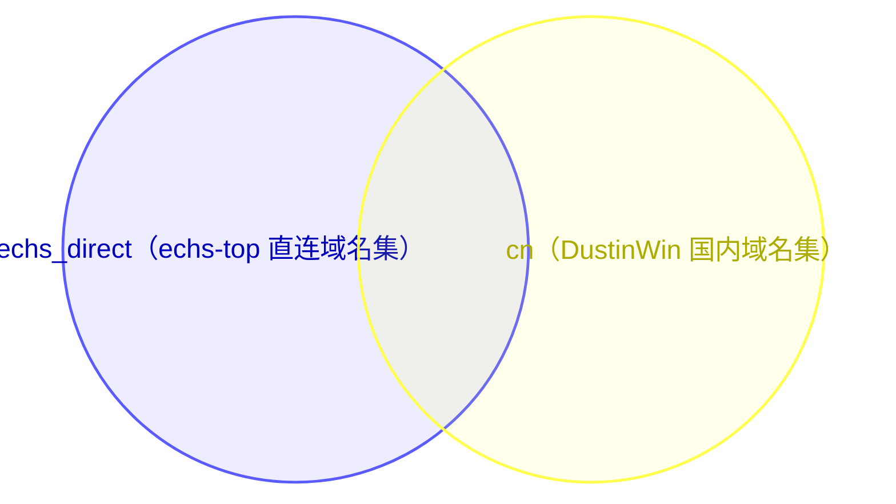
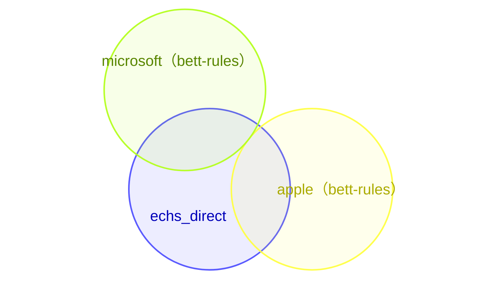
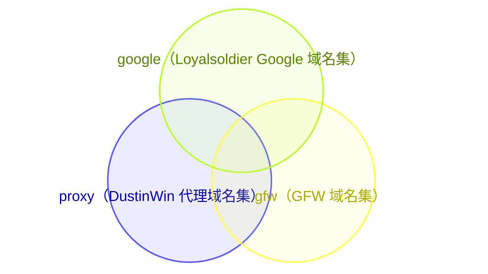
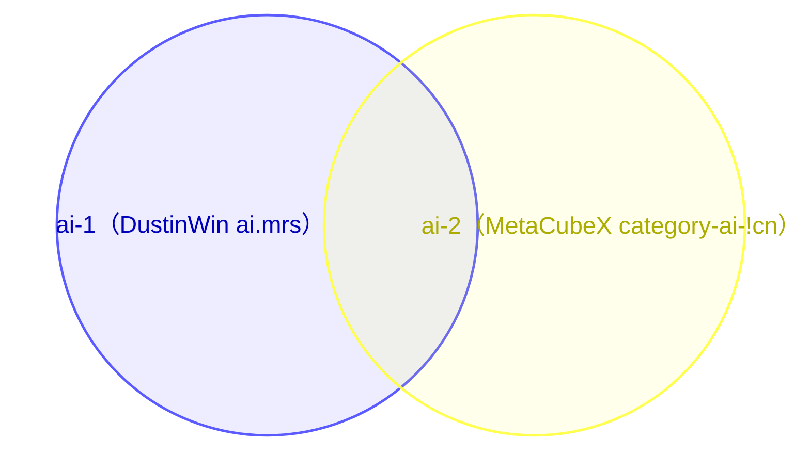

<p align="center">
  
</p>

<h1 align="center">XVSVT's Mihomic Config</h1>

<p align="center">
  <strong>自用</strong> · 路由配置 · 远程覆写脚本
</p>

<p align="center">
  <a href="LICENSE"></a>
  <a href="https://github.com/XVSVTsama/XVSVT-Clash-Config/commits/main"></a>
  <a href="https://github.com/XVSVTsama/XVSVT-Clash-Config"></a>
  <a href="https://github.com/XVSVTsama/XVSVT-Clash-Config/stargazers"></a>
  <a href="https://github.com/XVSVTsama"></a>
</p>

<p align="center">
  <a href="mihomo.yaml"></a>
  <a href="https://github.com/XVSVTsama/XVSVT-Clash-Config/actions/workflows/yaml-syntax.yml"></a>
  <a href="script_override.js"></a>
  <a href="https://github.com/XVSVTsama/XVSVT-Clash-Config/actions/workflows/js-syntax.yml"></a>
  <a href="https://github.com/XVSVTsama/XVSVT-Clash-Config/actions/workflows/mihomo-check.yml"></a>
</p>

<p align="center">
  <a href="#remote-override">远程覆写地址</a> ·
  <a href="#yaml-config">YAML 说明</a> ·
  <a href="#script-override">JavaScript 说明</a> ·
  <a href="#dns-model">dns-host背景说明</a> ·
  <a href="#ruleset-overlap">规则集重合</a> ·
  <a href="#acknowledgments">致谢</a> ·
  <a href="#star-history">Star History</a> ·
  <a href="#disclaimer">免责声明</a>
</p>

---

<a id="remote-override"></a>

## 🔗 远程覆写脚本地址

   默认地址：

```text
https://raw.githubusercontent.com/XVSVTsama/XVSVT-Clash-Config/refs/heads/main/script_override.js
```

<table width="100%">
<thead>
<tr><th width="100%" align="center">CDN地址</th></tr>
</thead>
<tbody>
<tr><td align="center"><div align="center"><a href="https://gh-proxy.com/https://raw.githubusercontent.com/XVSVTsama/XVSVT-Clash-Config/refs/heads/main/script_override.js">gh-proxy</a>：全球 Anycast，更新即时，无缓存</div></td></tr>
<tr><td align="center"><div align="center"><a href="https://cdn.jsdmirror.com/gh/XVSVTsama/XVSVT-Clash-Config@main/script_override.js">jsdmirror</a>：腾讯云 EdgeOne，自动同步源站</div></td></tr>
</tbody>
</table>

<a id="yaml-config"></a>

<br>

<h2 align="center">🧱 YAML 说明</h2>

<br>

`mihomo.yaml` 是本仓库的基准配置模板：一份不含任何节点的完整配置骨架，不可直接使用它。

<a id="proxy-groups"></a>

### 🗂 分流组结构（按 `mihomo.yaml` 定义）

本节分三层：先看核心代理组的骨架与嵌套，再看每个基础代理组的用途与路由规则，最后看三组的特别说明。

#### 核心代理组

<table width="100%">
<thead>
<tr><th width="20%">代理组</th><th width="80%">嵌套关系</th></tr>
</thead>
<tbody>
<tr><td><strong>🌍 PROXY</strong></td><td>唯一的顶层入口，不直接纳入节点（无 <code>include-all</code>），实际节点经被嵌套的三组进入；组内只有以下四项：<br><code>👉 手动切换</code><br><code>♻️ 自动选择</code><br><code>🔄 负载均衡</code><br><code>DIRECT</code></td></tr>
<tr><td><strong>👉 手动切换</strong></td><td>被 <strong>🌍 PROXY</strong> 嵌套；自身以 <code>include-all</code> 纳入所有可用节点，不再嵌套其他代理组</td></tr>
<tr><td><strong>♻️ 自动选择</strong></td><td>被 <strong>🌍 PROXY</strong> 嵌套；自身以 <code>include-all</code> 纳入所有可用节点，不再嵌套其他代理组</td></tr>
<tr><td><strong>🔄 负载均衡</strong></td><td>被 <strong>🌍 PROXY</strong> 嵌套；自身以 <code>include-all</code> 纳入所有可用节点，不再嵌套其他代理组</td></tr>
</tbody>
</table>

#### 基础代理组

<table width="100%">
<thead>
<tr><th width="15%">代理组</th><th width="25%">用途</th><th width="60%">路由规则</th></tr>
</thead>
<tbody>
<tr><td><strong>🍎 海外苹果</strong></td><td>海外 Apple 服务单独选出口</td><td>引用规则集合：<code>apple</code>、<code>apple_ip</code></td></tr>
<tr><td><strong>💠 海外微软</strong></td><td>海外 Microsoft 服务单独选出口</td><td>引用规则集合：<code>microsoft</code>、<code>microsoft_ip</code></td></tr>
<tr><td><strong>📲 Telegram</strong></td><td>Telegram 单独选出口</td><td>引用规则集合：<code>telegram_domain</code>、<code>telegramcidr</code><br>使用进程名称正则表达式匹配：telegram、nagram</td></tr>
<tr><td><strong>✖️ Twitter</strong></td><td>Twitter / X 单独选出口</td><td>引用规则集合：<code>twitter-x-domain</code>、<code>twitter-x-ip</code>、<code>twitter-x-aggregate</code><br>使用进程名称正则表达式匹配：twitter</td></tr>
<tr><td><strong>🤖 AI大模型</strong></td><td>AI 服务单独选出口</td><td>引用规则集合：<code>ai-1</code>、<code>ai-2</code>、<code>Gemini_Domain</code>、<code>Grok_Domain</code><br>使用域名后缀匹配：anthropic.com、claude.ai、claude.com、claudeusercontent.com、clau.de、frame.claudeusercontent.com、metaaivm.com、modelcontextprotocol.io、muse.ai、sentry.io、statsigapi.net<br>使用域名精确匹配：共 31 个域名（api.anthropic.com、downloads.claude.ai、api.meta.ai、hatch-api.meta.ai 等）<br>使用域名关键词匹配：datadog、sift<br>使用进程名称匹配：com.facebook.aura<br>使用进程名称正则表达式匹配：claude、anthropic、manus<br>使用 IP 段匹配：160.79.104.0/21、17.253.4.0/23、2607:6bc0::/48</td></tr>
<tr><td><strong>🎵 TikTok</strong></td><td>TikTok 单独选出口</td><td>引用规则集合：<code>TikTok</code></td></tr>
<tr><td><strong>💳 金融支付</strong></td><td>支付与加密货币单独选出口</td><td>引用规则集合：<code>category-cryptocurrency</code>、<code>paypal</code>、<code>stripe</code>、<code>visa</code>、<code>mastercard</code>、<code>wise</code><br>使用域名精确匹配：d3r7nsslvs6aaf.cloudfront.net、bybit-exchange.github.io<br>使用进程名称匹配：共 24 个交易所 / 钱包 App 进程名（com.binance.dev、com.coinbase.android、com.okinc.okex.gp 等）</td></tr>
<tr><td><strong>🔎 Google</strong></td><td>Google 服务单独选出口</td><td>引用规则集合：<code>google</code>、<code>google-cn</code></td></tr>
<tr><td><strong>♾️ Meta</strong></td><td>Meta 服务单独选出口</td><td>引用规则集合：<code>meta</code></td></tr>
<tr><td><strong>🎧 Spotify</strong></td><td>Spotify 单独选出口</td><td>引用规则集合：<code>spotify</code></td></tr>
<tr><td><strong>🎬 Emby</strong></td><td>Emby 类客户端单独选出口</td><td>使用进程名称匹配：com.mountains.hills、com.hamhub.app、com.oumi.utility.media.hub、com.feifeiduck.capyplayer、com.attempt.afusekt、com.hush.yamby、com.railux.mobile</td></tr>
<tr><td><strong>💬 Discord</strong></td><td>Discord 单独选出口</td><td>引用规则集合：<code>discord</code></td></tr>
<tr><td><strong>👽 Reddit</strong></td><td>Reddit 单独选出口</td><td>引用规则集合：<code>reddit</code></td></tr>
<tr><td><strong>🎥 Netflix</strong></td><td>Netflix 单独选出口</td><td>引用规则集合：<code>netflix</code></td></tr>
<tr><td><strong>💝 Patreon</strong></td><td>Patreon 单独选出口</td><td>引用规则集合：<code>patreon</code></td></tr>
<tr><td><strong>📚 EHentai</strong></td><td>EHentai 单独选出口</td><td>引用规则集合：<code>ehentai</code></td></tr>
<tr><td><strong>☁️ PikPak</strong></td><td>PikPak 单独选出口</td><td>引用规则集合：<code>pikpak</code></td></tr>
<tr><td><strong>💬 LINE</strong></td><td>LINE 单独选出口</td><td>引用规则集合：<code>line</code></td></tr>
<tr><td><strong>🎮 Games-Global</strong></td><td>游戏流量单独选出口</td><td>引用规则集合：<code>games</code><br>使用进程名称匹配：bf6.exe</td></tr>
<tr><td><strong>🎮 Steam平台（非下载/CDN）</strong></td><td>Steam 平台流量单独选出口</td><td>引用规则集合：<code>steam</code>、<code>steam_ip</code></td></tr>
<tr><td><strong>FCM</strong></td><td>Google FCM 推送单独选出口</td><td>引用规则集合：<code>googlefcm</code></td></tr>
</tbody>
</table>
#### 特别组说明

以下三组同时属于基础代理组（见上表），嵌套结构不同于常规业务组，单独列出。

<table width="100%">
<thead>
<tr><th width="25%">代理组</th><th width="75%">嵌套结构</th></tr>
</thead>
<tbody>
<tr><td><strong>🎮 Games-Global</strong></td><td><code>🎮 Steam平台（非下载/CDN）</code>（默认选中）<br>所有可用节点（<code>include-all</code>）</td></tr>
<tr><td><strong>🎮 Steam平台（非下载/CDN）</strong></td><td><code>DIRECT</code>（默认选中）<br><code>👉 手动切换</code><br><code>♻️ 自动选择</code><br><code>🔄 负载均衡</code><br>所有可用节点（<code>include-all</code>）</td></tr>
<tr><td><strong>FCM</strong></td><td><code>👉 手动切换</code><br><code>DIRECT</code></td></tr>
</tbody>
</table>

<a id="before-use"></a>

### 🛠️ 使用前必改 (抄作业必看)

本配置按个人使用习惯定制，并非开箱即用的通用模板，尤其是对于直接导入 YAML 的使用形式。使用前请完成以下必要设置；如不熟悉 Mihomo、TUN、DNS 或策略组过滤规则，请先了解相关机制再使用。

1. **直接使用 YAML (`mihomo.yaml`)**：将 `proxy-providers.subscription.url` 的占位地址在本地替换为自己的 Clash/Mihomo 订阅链接；`include-all` 策略组会自动纳入 provider 节点。也可删除不用的示例 provider，将 `proxies: ~` 替换为自己的节点列表。模板不会自动读取客户端中的其他订阅，请勿把真实订阅链接或凭据提交到公开仓库。
2. **按需删减规则**：本配置的规则内容都有性能消耗，不需要的规则、规则集与策略组都可按需删减，例如不屏蔽番茄小说海外版广告的，删除 `sub-rules` 中的 `fanqie` 规则。`🛑 广告拦截`（SukkaW/Surge reject 规则集）在模板中为 `proxy-groups`、`rule-providers`、`rules` 三处注释段，不用时保持注释，需要时成套取消注释启用。

<a id="script-override"></a>

<br>

<h2 align="center">⚙️ JavaScript 说明</h2>

<br>

覆写脚本把订阅配置与本仓库维护的内嵌模板合并成最终配置：模板中已写好的字段（`dns`、`rules`、`rule-providers`、`sniffer`、`tun`、`proxy-groups` 分组结构等）以模板为准，节点与订阅自带 `proxy-providers` 来自订阅。脚本地址见页首 [远程覆写脚本地址](#remote-override)，在 Bettbox / FlClash 系客户端中给订阅挂上即可。

合并产物：

- **节点与代理组**：订阅里的真实节点填入顶层 `proxies`；常规动态节点组通过 Mihomo 原生 `include-all` 引入顶层节点与 provider 节点。固定策略项保留在各组的 `proxies` 列表中。
- **订阅自带 `proxy-providers`**：定义原样保留，脚本不展开、不筛选、不逐节点改写其中的节点；节点级开关能作用到 provider 的只有 `override` 通道。
- **国家/地区分组**：`国家/地区分组` 开启后，只从订阅顶层 `proxies` 生成香港、日本、新加坡、台湾、韩国、马来西亚、美国、加拿大、英国、法国、荷兰、德国、澳大利亚及“其他国家/地区”策略组；不枚举 `proxy-providers`。倍率筛选先于地区分组执行，地区组只用幸存节点生成；某地区节点全部被筛除时不生成该地区的父组与三个隐藏子组。
- **倍率筛选**：`高倍率筛选` 删除名称中明确标记为 `2x` 或更高的订阅顶层节点；`低倍率筛选` 删除明确标记为 `0.5x` 或更低的节点。只识别显式数值倍率（例如 `5x`），不猜测模糊标签；过滤同步清理代理组 `proxies` 中的节点名称引用，不处理 `proxy-providers`；执行顺序在地区分组与国内入口解析之前。
- **DNS**：动态合并出 `dns.proxy-server-nameserver-policy`（模板不预置该键，以脚本计算结果为准），细节见下方流程图。
- **开关声明**：脚本首行的 `Compatible_With_Bettbox` 兼容声明必须置顶——Bettbox 只在脚本开头识别该声明，删除或下移会导致"自定义规则开关"入口不显示；声明中的 `policyGroupOptions` 列出归入图形化开关分类的 23 个策略组，`ruleOptionsEnable` 则是实际生效的开关表，键名需与声明保持一致。`🌍 PROXY` 始终保留为基础/兜底组，不提供关闭开关。

<a id="provider-scope"></a>

### ⚠️ 设计局限：JS 覆写的能力边界

脚本只改写传入的配置对象，不联网、不读写文件、不读运行状态。不能做：联网、下载、上传、测速、读运行状态（当前选中节点、连接、流量），也不能调用客户端 API。

**会不会偷订阅**：不会，无网络。

**能不能加速代理**：不会，不参与代理。

**能不能读取 proxy-provider**：不能，但可以尽可能逼近，[<kbd>查看三维视图</kbd>](https://XVSVTsama.github.io/XVSVT-Clash-Config/provider-node-3d.html)

### 🔀 hosts / DNS 处理流程

[<kbd>在线查看：hosts / DNS 三种处理流程</kbd>](https://XVSVTsama.github.io/XVSVT-Clash-Config/hosts-dns-processing-flow.html)

### 🗂 代理组与 Bettbox 开关（脚本合并后）

脚本开头的 `Compatible_With_Bettbox` 声明用 `policyGroupOptions` 划定了"策略组开关"分类：只列进去的组出现在该分类下，没列进去的组不受它控制，改由脚本的 `ruleOptionsEnable` 决定存在形态（两者都在脚本顶部可查）。

**列入 `policyGroupOptions` 的策略组（23 个）**

<table width="100%">
<thead>
<tr><th width="42%">策略组名称</th><th width="43%">Bettbox 开关</th><th width="15%">默认</th></tr>
</thead>
<tbody>
<tr><td><strong>🔄 负载均衡</strong></td><td><code>🔄 负载均衡</code></td><td>开启</td></tr>
<tr><td><strong>👉 手动切换</strong></td><td><code>👉 手动切换</code></td><td>开启</td></tr>
<tr><td><strong>♻️ 自动选择</strong></td><td><code>♻️ 自动选择</code></td><td>开启</td></tr>
<tr><td><strong>📲 Telegram</strong></td><td><code>📲 Telegram</code></td><td>开启</td></tr>
<tr><td><strong>🎮 Games-Global</strong></td><td><code>🎮 Games-Global</code></td><td>开启</td></tr>
<tr><td><strong>🍎 海外苹果</strong></td><td><code>🍎 海外苹果</code></td><td>开启</td></tr>
<tr><td><strong>💠 海外微软</strong></td><td><code>💠 海外微软</code></td><td>开启</td></tr>
<tr><td><strong>🎮 Steam平台（非下载/CDN）</strong></td><td><code>🎮 Steam平台（非下载/CDN）</code></td><td>开启</td></tr>
<tr><td><strong>✖️ Twitter</strong></td><td><code>✖️ Twitter</code></td><td>开启</td></tr>
<tr><td><strong>🤖 AI大模型</strong></td><td><code>🤖 AI大模型</code></td><td>开启</td></tr>
<tr><td><strong>🎵 TikTok</strong></td><td><code>🎵 TikTok</code></td><td>开启</td></tr>
<tr><td><strong>💳 金融支付</strong></td><td><code>💳 金融支付</code></td><td>开启</td></tr>
<tr><td><strong>🔎 Google</strong></td><td><code>🔎 Google</code></td><td>开启</td></tr>
<tr><td><strong>♾️ Meta</strong></td><td><code>♾️ Meta</code></td><td>开启</td></tr>
<tr><td><strong>🎧 Spotify</strong></td><td><code>🎧 Spotify</code></td><td>开启</td></tr>
<tr><td><strong>🎬 Emby</strong></td><td><code>🎬 Emby</code></td><td>开启</td></tr>
<tr><td><strong>💬 Discord</strong></td><td><code>💬 Discord</code></td><td>开启</td></tr>
<tr><td><strong>👽 Reddit</strong></td><td><code>👽 Reddit</code></td><td>开启</td></tr>
<tr><td><strong>🎥 Netflix</strong></td><td><code>🎥 Netflix</code></td><td>开启</td></tr>
<tr><td><strong>💝 Patreon</strong></td><td><code>💝 Patreon</code></td><td>开启</td></tr>
<tr><td><strong>📚 EHentai</strong></td><td><code>📚 EHentai</code></td><td>开启</td></tr>
<tr><td><strong>☁️ PikPak</strong></td><td><code>☁️ PikPak</code></td><td>开启</td></tr>
<tr><td><strong>💬 LINE</strong></td><td><code>💬 LINE</code></td><td>开启</td></tr>
</tbody>
</table>

这 23 个开关默认全部开启。关闭 20 个业务分流组时，会移除该组并删除指向它的路由规则，而不是把规则改写到 `🌍 PROXY`；只有在剩余规则和配置中均无引用的规则集才会清理。关闭 `🔄 负载均衡`、`👉 手动切换` 或 `♻️ 自动选择` 时仍沿用原有组引用和兜底处理。`🌍 PROXY` 始终保留为基础/兜底组。

**未列入 `policyGroupOptions` 的组**

<table width="100%">
<thead>
<tr><th width="20%">策略组名称</th><th width="14%">由哪个开关决定</th><th width="8%">默认</th><th width="58%">说明</th></tr>
</thead>
<tbody>
<tr><td><strong>FCM</strong></td><td><code>FCM直连</code></td><td>开启</td><td>开关不移除本组，只改写组内节点：开启=<code>DIRECT</code>；关闭且 <code>👉 手动切换</code> 已禁用时回退到全局兜底。脚本内嵌模板把本组标记为隐藏组（<code>hidden</code>）</td></tr>
<tr><td><em><strong>📲 Telegram(兜底)</strong></em></td><td><em><strong><code>TGDC实验分流</code></strong></em></td><td><em><strong>关闭</strong></em></td><td><em><strong>该开关开启时由 <code>📲 Telegram</code> 更名而来，承接 Telegram 进程、域名与 CIDR 规则</strong></em></td></tr>
<tr><td><strong>📲 Telegram-DC1-DC3-Miami</strong></td><td><code>TGDC实验分流</code></td><td>关闭</td><td>开关开启时按 Telegram DC IP 规则优先命中美国/迈阿密节点；地区无候选时列出全部合格节点供手动选择</td></tr>
<tr><td><strong>📲 Telegram-DC2-DC4-Amsterdam</strong></td><td><code>TGDC实验分流</code></td><td>关闭</td><td>同上，对应荷兰/阿姆斯特丹节点</td></tr>
<tr><td><strong>📲 Telegram-DC5-SG</strong></td><td><code>TGDC实验分流</code></td><td>关闭</td><td>同上，DC5 同时匹配新加坡与香港节点</td></tr>
<tr><td><em><strong>🛑 广告拦截</strong></em></td><td><em><strong><code>SKK广告拦截</code></strong></em></td><td><em><strong>关闭</strong></em></td><td><em><strong>开关关闭时本组、其 4 个规则集与 4 条规则都不生成；开启时组内可选 <code>REJECT</code> / <code>REJECT-DROP</code> / <code>PASS</code>，承接 SukkaW/Surge 的 reject 域名集与 non_ip 规则集，规则置于置顶拦截守卫之后；reject-drop 与 reject_ip 两条规则不经本组，分别直达 <code>REJECT-DROP</code> 与 <code>REJECT</code></strong></em></td></tr>
<tr><td><strong>国内入口解析</strong></td><td><code>入口解析</code></td><td>关闭</td><td>开关开启时统一注入维护区所有运营商的入口节点并建立该组，由用户手动选择入口；每个运营商支持多个节点，排列顺序不代表优先级</td></tr>
<tr><td><strong>国家/地区父组及隐藏子组</strong></td><td><code>国家/地区分组</code></td><td>关闭</td><td>根据地区候选节点创建分组；将父组追加到 15 个指定流量目标中，跳过已禁用或不存在的目标；地区节点被倍率筛选全部剔除时不生成该地区的父组与三个隐藏子组</td></tr>
</tbody>
</table>

**同样不在 `policyGroupOptions`、也不对应任何策略组的开关（9 个）**

<table width="100%">
<thead>
<tr><th width="18%">开关</th><th width="8%">默认</th><th width="74%">作用</th></tr>
</thead>
<tbody>
<tr><td><code>强制证书验证</code></td><td>关闭</td><td>开启时统一把订阅顶层节点的 <code>skip-cert-verify</code> 置为 <code>false</code>；provider 节点经 <code>override.skip-cert-verify</code> 同步生效；关闭时不干预订阅原有设置</td></tr>
<tr><td><code>启用 Reality 增强</code></td><td>开启</td><td>为带非空 <code>public-key</code> / <code>short-id</code> 的订阅顶层 Reality 节点启用 X25519MLKEM768 后量子密钥协商；provider 的 <code>override</code> 只能改固定字段、无法改写嵌套 <code>reality-opts</code>，因此不涉及 provider 节点</td></tr>
<tr><td><code>试开启节点UDP</code></td><td>关闭</td><td>开启时为订阅顶层节点设置 <code>udp: true</code>，provider 节点经 <code>override.udp</code> 同步生效；关闭时不改动原有设置</td></tr>
<tr><td><code>IPv6优先</code></td><td>关闭</td><td>改写订阅顶层节点 <code>ip-version</code>：<code>ipv6</code> 保持不变，<code>ipv6-prefer</code> 改为 <code>ipv6</code>，其余设为 <code>ipv6-prefer</code>；provider 节点经 <code>override.ip-version</code> 统一设为 <code>ipv6-prefer</code>，无法按节点区分原值</td></tr>
<tr><td><code>高倍率筛选</code></td><td>关闭</td><td>在地区分组之前删除名称中显式标记倍率 <code>&gt;=2x</code> 的订阅顶层节点，并从静态代理组节点列表中移除其名称；不处理 provider 运行时节点</td></tr>
<tr><td><code>低倍率筛选</code></td><td>关闭</td><td>在地区分组之前删除名称中显式标记倍率 <code>&lt;=0.5x</code> 的订阅顶层节点，并从静态代理组节点列表中移除其名称；不处理 provider 运行时节点</td></tr>
<tr><td><code>国家/地区分组</code></td><td>关闭</td><td>只用倍率筛选后的订阅顶层节点生成国家/地区选择组；共用官网、流量说明等节点过滤，但不改变目标组的 <code>include-all</code>。该开关独立于 <code>入口解析</code></td></tr>
<tr><td><code>代理节点 DNS 使用 TCP</code></td><td>关闭</td><td>为代理节点解析 DNS 中未标协议的地址启用 TCP；显式协议不变</td></tr>
<tr><td><code>WebRTC阻断</code></td><td>开启</td><td>开启时保持模板规则不变；关闭时移除所有同时包含 <code>NETWORK,UDP</code> 与 <code>DST-PORT,3478-3479/5349-5350/19302-19309</code> 的规则</td></tr>
</tbody>
</table>

> **关于客户端**：这套图形化开关由 Bettbox 原生支持——脚本开头的 `Compatible_With_Bettbox` 声明就是给 Bettbox 识别用的。换到其他客户端分两种情况：
>
> - 支持 JS 覆写脚本、但没有开关面板的客户端（例如 FlClash）：需要自行打开 `script_override.js`，把 `ruleOptionsEnable` 里对应开关的值改成 `true` 或 `false`，保存后重新加载订阅即可生效；
> - 不支持 JS 覆写脚本的客户端：没有这个入口，只能改用 `mihomo.yaml` 模板自行维护策略组。

<a id="dns-model"></a>

<br>

<h2 align="center">hosts真假域名映射-私有DoH复合DNS流程</h2>

<br>

[<kbd>在线阅读：节点域名、Hosts 与私有 DNS 联动模型</kbd>](https://XVSVTsama.github.io/XVSVT-Clash-Config/proxy-infrastructure-domain-protection-model.html)

<a id="ruleset-overlap"></a>

<br>

<h2 align="center">🧮 规则集重合关系（额外说明）</h2>

<br>

本小节不属于 YAML 或脚本单方面的说明：本仓库引用的规则集来自多个上游，彼此存在规则集与规则集之间的覆盖重合。下面按重合的集合分组，全部用韦恩图说明。

**1. 国内直连的两个来源**



两组规则有部分重合；重合域名按配置顺序先命中 `echs_direct`，两组最终都走 `DIRECT`。

**2. 直连规则集与海外组规则集**



`apple` / `microsoft` 的国内部分落在 `echs_direct` 里，`rules` 把 `echs_direct` 排在海外组之前，重合部分先走 `DIRECT`；`games` 与 `echs_direct` 同理。

**3. 出海域名集的多个来源**



三者覆盖的都是"需要走代理的域名"，在 `rules` 中同指 `🌍 PROXY`。

**4. Twitter 规则集**
Twitter 流量由 `twitter-x-domain`、`twitter-x-ip` 与 `twitter-x-aggregate` 处理，均路由到 `✖️ Twitter`。聚合列表共 36 条规则；与原列表的 33 条相比，原条目全部保留，并新增 `DOMAIN-SUFFIX,twitter.map.fastly.net`、`IP-CIDR,104.244.42.0/21,no-resolve` 和 `IP-CIDR,199.16.156.0/22,no-resolve`。

**5. 两套 AI 规则集**



两套来源不同却覆盖同类站点，在 `rules` 中同指 `🤖 AI大模型`。

> 以上重合关系按各规则集的覆盖范围与来源判断（依据取自 `mihomo.yaml` 的 `rules:` 引用与注释）。

---

<a id="acknowledgments"></a>

<br>

<h2 align="center">🙏 致谢</h2>

<br>

本项目建立在开源内核、客户端、规则集与图标资源之上。以下列出本项目使用或参考的相关项目；引用或参考不代表这些项目与本仓库存在合作或背书关系。具体资源请以各上游项目的说明和许可为准。

### 内核与客户端

- [Mihomo](https://github.com/MetaCubeX/mihomo)
- [Bettbox](https://github.com/appshubcc/Bettbox)
- [FlClash](https://github.com/chen08209/FlClash)

### 规则集作者与原项目

- [MetaCubeX/meta-rules-dat](https://github.com/MetaCubeX/meta-rules-dat)
- [DustinWin/ruleset_geodata](https://github.com/DustinWin/ruleset_geodata)
- [echs-top/proxy](https://github.com/echs-top/proxy)
- [appshubcc/bett-rules](https://github.com/appshubcc/bett-rules)
- [reddishJade/private_proxy](https://github.com/reddishJade/private_proxy)
- [Accademia/Additional_Rule_For_Clash](https://github.com/Accademia/Additional_Rule_For_Clash)
- [Loyalsoldier/clash-rules](https://github.com/Loyalsoldier/clash-rules)
- [blackmatrix7/ios_rule_script](https://github.com/blackmatrix7/ios_rule_script)


### 图标作者与原项目

- [Koolson/Qure](https://github.com/Koolson/Qure) 与 [MiToverG422/Qure](https://github.com/MiToverG422/Qure)
- [DustinWin/ruleset_geodata](https://github.com/DustinWin/ruleset_geodata)
- [AIsouler/MyClash](https://github.com/AIsouler/MyClash)
- [Clash Verge](https://www.clashverge.dev/)
- [Simple Icons](https://github.com/simple-icons/simple-icons)
- 荷兰国旗图标由本项目自行绘制，并托管于 [`assets/icons/self-Netherlands.png`](assets/icons/self-Netherlands.png)。

各图标文件的来源、许可、可使用范围及 SVG 优先维护约定，统一见 [图标资源与使用说明](assets/icons/README.md)。

### 脚本与配置参考

- [AIsouler/MyClash](https://github.com/AIsouler/MyClash)
- [echs-top/proxy](https://github.com/echs-top/proxy)
- [HenryChiao/MIHOMO_YAMLS](https://github.com/HenryChiao/MIHOMO_YAMLS)

以上参考均用于学习与对照，具体实现以本仓库代码为准。

<a id="star-history"></a>

<br>

<h2 align="center">⭐ Star History</h2>

<br>

[](https://star-history.com/#XVSVTsama/XVSVT-Clash-Config&Date)

<a id="disclaimer"></a>

<br>

<h2 align="center">⚠️ 免责声明</h2>

<br>

1. 本仓库的YAML模板与JS脚本设计并非完美，或可能有代码质量问题，也不一定适合所有环境，尤其是 DNS 与路由规则。
2. 使用者应自行评估使用、修改或传播本仓库内容所涉及的风险，并遵守所在地区适用的法律法规。因使用本仓库内容产生的后果，由使用者自行承担。
